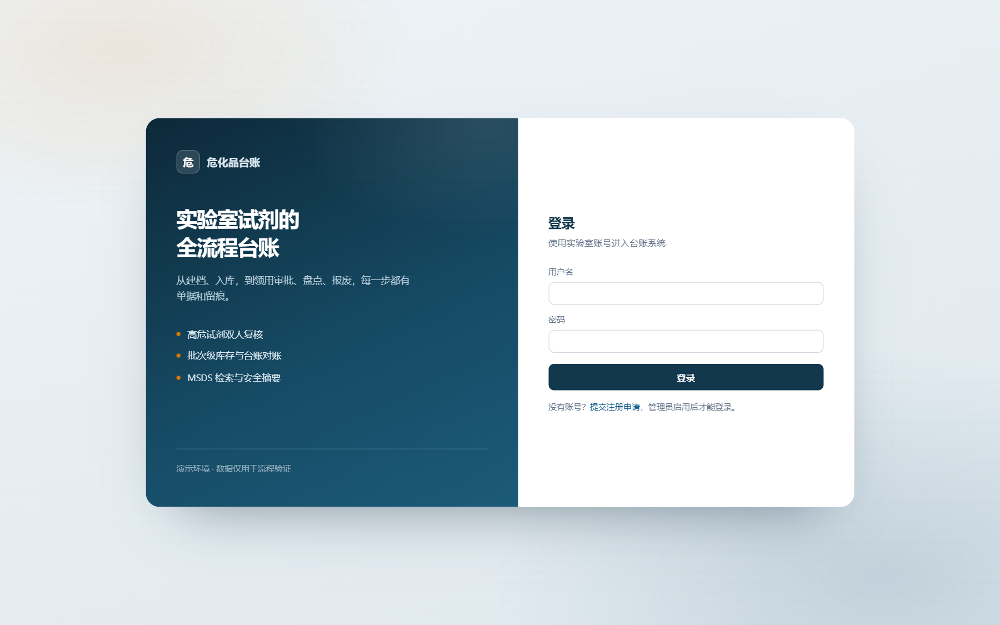
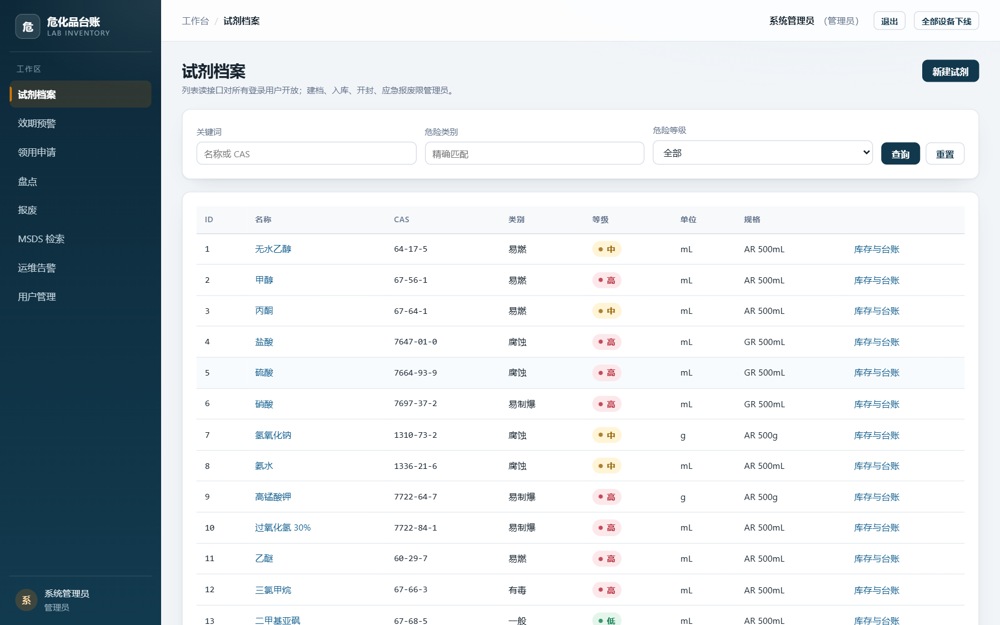
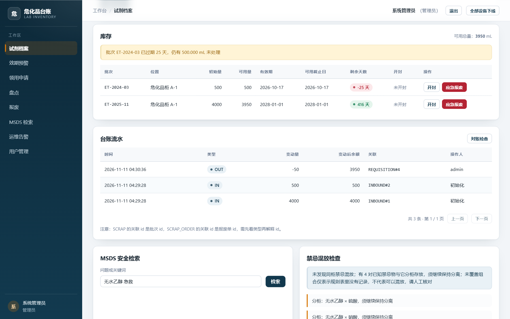
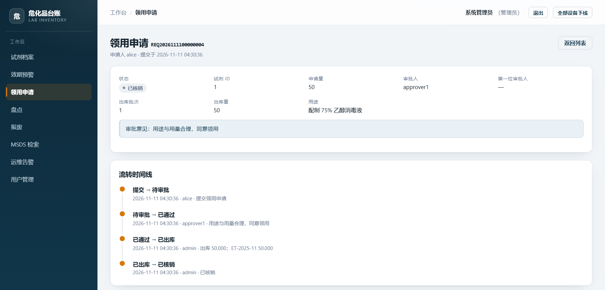
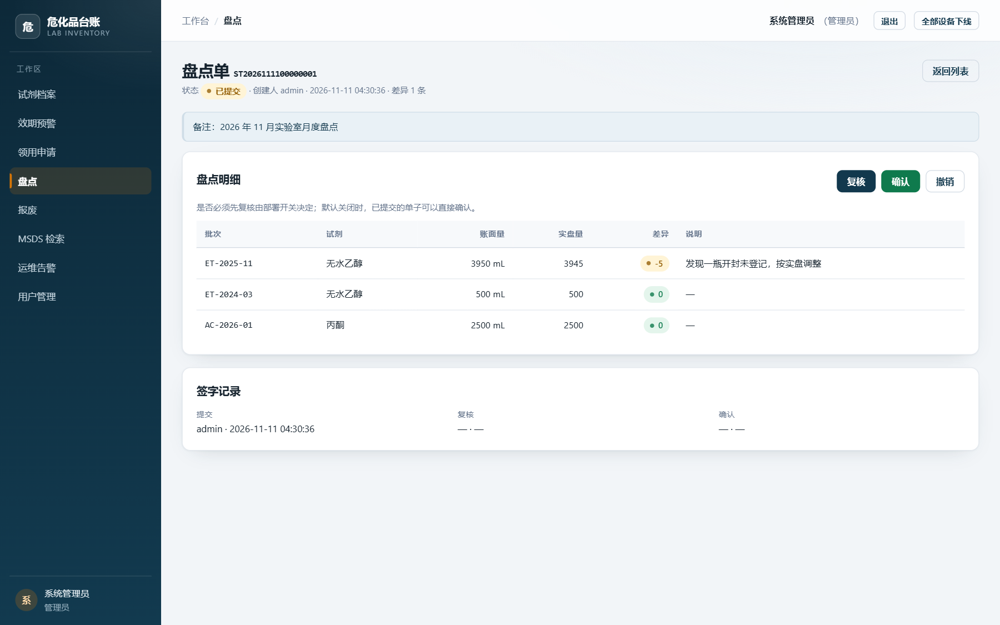
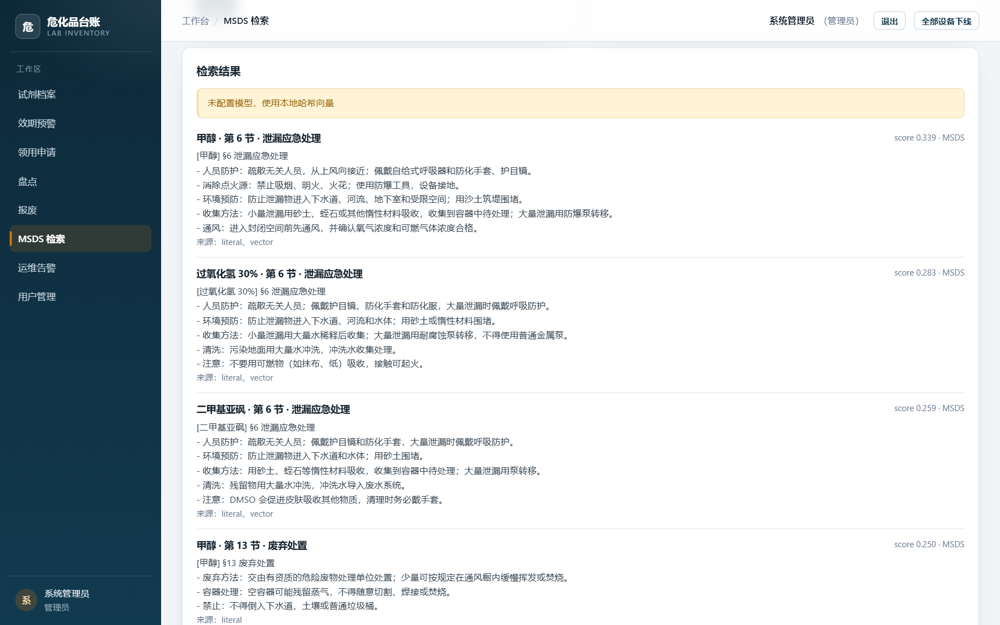

# hazmat-ledger · 高校实验室危化品领用与台账管理

> Spring Boot 3.5 / Java 21 的危化品全流程台账，默认 H2，可切 MySQL。
> 两条主线：**领用申请 → 审批（高危双人） → FEFO 出库 → 台账**，以及 **盘点 → 确认调账 → 对账**。
> 另有 MSDS 检索与带引用问答、禁忌混放检查、报废审批、运维巡检和随 jar 发布的静态演示前端。
> 默认测试套件 273 个用例，不需要任何中间件。

项目起点：学校原教务系统在实验课集中开课时扛不住领用与库存查询的并发，危化品链路被拆成独立服务。
拆出来后还要回答强追溯问题：谁在何时领了哪瓶、出自哪个批次、谁批准、账实不符时差在哪一笔。

---

## 界面演示

截图来自本机 Docker 环境，使用脚本通过公开接口写入的演示数据。

**登录**

页面匿名可打开，登录拿到的 token 才用于调用 `/api/**`。



**试剂档案**

列表按角色显示操作入口，点名称进入库存与台账。



**库存与台账**

批次可用量、效期预警、出入库流水和对账检查在同一页；底部接 MSDS 检索与禁忌混放检查。



**领用详情**

状态、审批人、出库批次和用途在一屏内，时间线记录每次状态变化与审批意见。



**盘点单**

按批次列出账面量、实盘量和差异；复核与职责分离由开关控制。



**MSDS 检索**

输入问题或 CAS 号，返回命中的章节原文与来源；`score` 是检索分数，不代表结论可信度。



最短演示路径：

1. `admin` 登录，打开「试剂档案」→「无水乙醇」→「库存与台账」。
2. 换 `alice` 提交领用，换 `approver1` 审批，再用 `admin` 出库、核销；每操作一步，详情时间线会多一条。
3. `admin` 在「盘点」建单，录入实盘量并提交。
4. 在「MSDS 检索」输入「甲醇 泄漏 应急处理」，查看命中章节和来源。

---

## 功能与角色

| 主线 | 链路 | 核心问题 |
|---|---|---|
| 一 | 领用申请 → 审批（高危双人） → FEFO 出库 → 台账 | 一笔领用怎么走完；并发下怎么不超发、不重复批 |
| 二 | 建单冻结 → 实盘录入 → 确认调账 → 对账 | 账实不符怎么发现、怎么调、怎么证明调后是对的 |

旁路功能：MSDS 检索与带引用问答、禁忌混放检查、报废申请审批、效期与盘点巡检告警。
旁路失败不影响开单、出库与台账写入。

| 账号 | 角色 | 主要操作 |
|---|---|---|
| `admin` | ADMIN | 建档、入库、出库、核销、盘点、应急报废、账号与索引管理 |
| `approver1` / `approver2` | APPROVER | 审批领用与报废，查看他人申请 |
| `alice` / `bob` | USER | 提交领用与报废，查看自己的申请与安全摘要 |

---

## 快速开始

要求 JDK 21。机器上同时装了更高版本时，显式指定 `JAVA_HOME`；Lombok 在新 JDK 上会静默失效，
表现为大量「找不到符号」。

```bash
export JAVA_HOME="/c/Program Files/Java/jdk-21.0.11"
./mvnw spring-boot:run        # 端口 8090，自动灌 18 条试剂档案、21 个批次
./mvnw test                   # 273 个测试，不需要任何中间件
```

打开 `http://localhost:8090/`。演示前端是 `index.html` + `app.js` + `styles.css` 三个静态文件，
Vue 3.5.45 放在 `src/main/resources/static/vendor/`，不依赖 CDN 或 Node 构建；静态资源带 `?v=3`，
`index.html` 返回 `no-cache`。

演示账号密码都取自 `hazmat.security.seed-password`，默认 `ChangeMe123!`。部署前改掉默认密码，
或关闭 `hazmat.security.seed-users`。

```bash
curl -s -X POST http://localhost:8090/api/auth/login \
  -H 'Content-Type: application/json' \
  -d '{"username":"alice","password":"ChangeMe123!"}'
# 取返回 data.token，之后请求加 -H "Authorization: Bearer <token>"
```

### MySQL 与容器

```bash
./mvnw package -DskipTests
java -jar target/hazmat-ledger-0.0.1-SNAPSHOT.jar --spring.profiles.active=mysql
```

连接配置在 `application-mysql.properties`，全部走环境变量：`DB_HOST`、`DB_PORT`、`DB_NAME`、
`DB_USERNAME`、`DB_PASSWORD`。表结构由 Flyway V1–V17 创建，Hibernate 只做 validate。
生产 profile 还要求 `HAZMAT_JWT_SECRET`（≥32 字节），缺失或仍用开发默认值会拒绝启动。

```bash
cp .env.example .env              # 填 DB_PASSWORD 与 HAZMAT_JWT_SECRET；.env 已被忽略
docker compose up -d --build      # app(8090) + mysql(3307) + rabbitmq(5672 / 管理台 15672)
curl http://localhost:8090/actuator/health
```

镜像两阶段构建：Maven + JDK 21 打包，运行阶段只留 JRE，以非 root 用户启动。
RabbitMQ 只承载 MSDS 向量编码任务，默认关闭；`compose.yaml` 默认打开。库存扣减、审批、
出库、盘点和登录都不经过 MQ。pgvector 放在单独 profile，默认用内存向量即可。

MySQL 8.4 迁移和 RabbitMQ 链路各有 Testcontainers 用例，需要 Docker：
`./mvnw -Dapi.version=1.44 -Dtest=MySqlMigrationIT test`、
`./mvnw -Dapi.version=1.44 -Dtest=MsdsEncodeMqIT test`。

### 接口文档与探活

- Swagger UI：`http://localhost:8090/swagger-ui.html`
- OpenAPI JSON：`http://localhost:8090/v3/api-docs`
- 健康检查：`/actuator/health`、`/actuator/health/readiness`
- 指标：`/actuator/prometheus`

---

## 核心设计

- **状态与并发**：领用、盘点、报废的状态迁移写在枚举的 `canTransitionTo` 里；库存扣减用数据库条件
  UPDATE，盘点调账和报废审批用 `@Version` 乐观锁，不依赖应用层锁。
- **双人复核**：高危试剂第一位审批人通过后进入 `PENDING_SECOND`，需要另一位审批人再通过；
  申请人不能审批自己的申请。
- **FEFO 出库**：按批次 `usableUntil` 从早到晚扣减，账本只追加；批次余额与最后一笔流水可逐笔复现。
- **开封可用期**：开封时间落库，可用截止日取「包装有效期」与「开封日 + postOpenDays」的较小值；
  已过期批次不再出库，但保留在库存视图里提示处理。
- **盘点**：建单时冻结账面量，提交要求全部批次已录入；确认时把差异写成 `ADJUST` 流水。
  `REVIEWED` 是否强制、提交人/复核人/确认人是否必须分离，都由配置控制。
- **业务单号与多实例**：单号用数据库号段分配，两个实例拿到互不相交的区间；MSDS 索引重建用数据库行锁串行化。
- **MSDS 检索**：按 GB/T 16483 的 16 节切块，字面检索与向量检索用 RRF 融合；`/ask` 的引用由后端生成，
  模型只能选编号，越界或没有有效引用时退回原文摘录。
- **禁忌混放**：关系表存 CAS 对与依据，按批次柜位判断是否真的同柜；规则表没有的组合显式返回
  `uncovered`。检查失败不影响台账写入。
- **过载与巡检**：连接池、语句超时和检索许可控制在单实例内生效；效期、对账、盘点超时和编码任务清理
  由定时任务写入运维告警，按 `fingerprint` 合并。

领用主状态机：

```
PENDING ──审批通过（普通试剂）──────────────> APPROVED ──出库──> ISSUED ──核销──> CLOSED
   │  └──第一人通过（高危试剂）──> PENDING_SECOND ──第二人通过──┘
   ├──审批驳回──> REJECTED
   └──本人撤回──> CANCELLED
```

---

## 接口摘要

| 范围 | 主要路径 | 说明 |
|---|---|---|
| 认证与账号 | `/api/auth/*`、`/api/users/*` | 登录、改密、撤销全部 token；管理员建号、改角色、启停、重置密码 |
| 试剂与库存 | `/api/chemicals/*` | 建档、入库、开封、库存、流水、效期预警、对账、安全摘要、混放检查 |
| 领用 | `/api/requisitions/*` | 提交、审批、出库、核销、撤回、详情时间线 |
| 盘点 | `/api/stocktakes/*` | 建单、录入实盘量、提交、复核、确认调账、撤销 |
| 报废 | `/api/scraps/*` | 申请、审批并扣减、驳回、撤销；管理员保留应急报废入口 |
| MSDS | `/api/msds/*` | 检索、带引用问答、重建索引、状态、编码任务、向量对账、回滚 |
| 运维与报表 | `/api/ops/alerts`、`/api/reports/*` | 告警查询与解决；库存汇总与出入库趋势（MyBatis-Plus 只读） |
| 探活与文档 | `/actuator/*`、`/swagger-ui.html` | 健康检查、Prometheus 指标、OpenAPI |

列表统一返回 `content/page/size/totalElements/totalPages/hasNext`；页码从 0 开始，`size` 上限 100，
排序字段走白名单，并始终追加 `id` 保证翻页稳定。身份只来自 token，请求体不能指定申请人或审批人。

接口的权威定义以运行时 `/v3/api-docs` 为准。

---

## 代码结构

```
src/main/java/com/lazybone/hazmat/
├── entity/ repository/   试剂、批次、领用、盘点、报废、流水、用户、MSDS 块、告警与号段
├── service/              StockService 出入库与对账 / RequisitionService 领用流程
│                         StocktakeService 盘点调账 / ScrapOrderService 报废审批
│                         DocumentNoService 号段 / ChemicalSafetyService 台账与检索的连接点
├── msds/                 切块、字面索引、向量索引、RRF 融合、编码队列与降级
├── controller/           各业务接口与演示前端入口
├── security/ config/     JWT 过滤链、登录失败计数、统一错误响应、OpenAPI 配置
├── ops/ report/ seed/    定时巡检、MyBatis-Plus 只读报表、种子数据
└── common/               分页、异常、统一响应

src/main/resources/
├── db/migration/         Flyway V1–V17
├── mapper/               报表 XML
├── msds/                 18 份按 16 节结构整理的演示文本
└── static/               演示前端（含本地 Vue 运行时）
```
